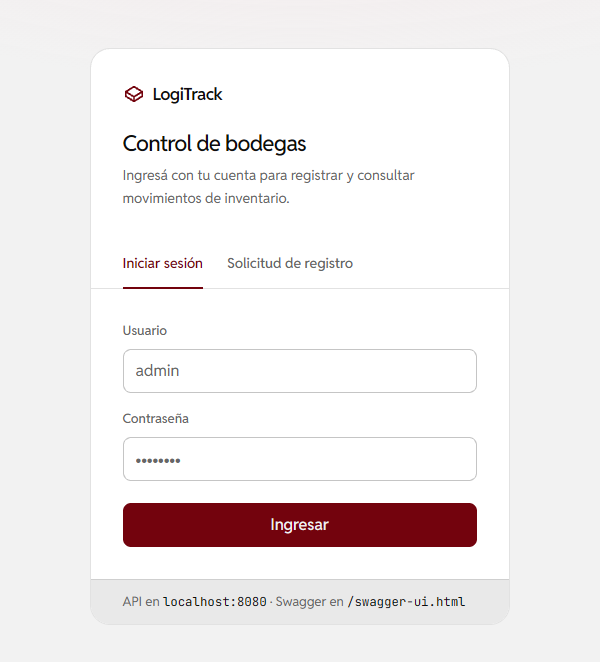
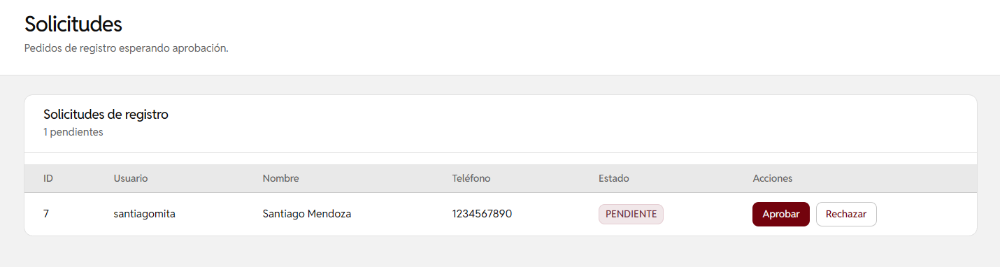
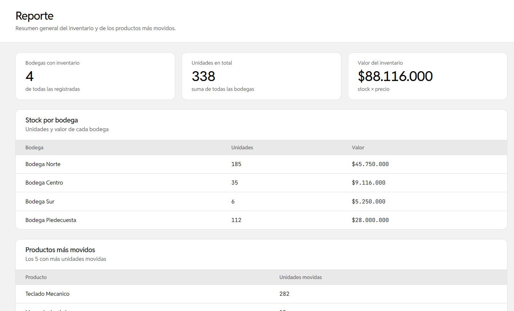
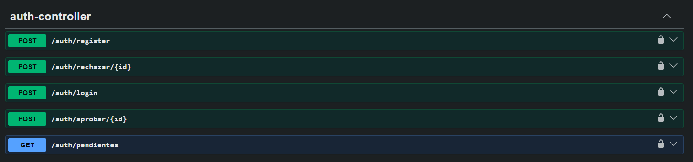

# LogiTrack S.A. — Sistema de Gestión y Auditoría de Bodegas

Backend en **Spring Boot** para administrar bodegas distribuidas, controlar movimientos de
inventario (entradas, salidas y transferencias) y **auditar automáticamente** cada cambio
sobre la base de datos, con autenticación **JWT** y roles **ADMIN / EMPLEADO**.

📄 **[Manual de usuario (PDF)](manual/manual-de-usuario.pdf)** — cómo entrar, registrar
movimientos, consultar el inventario y probar la API en Swagger.

---

## Tecnologías

| Tecnología | Versión |
|---|---|
| Java | 17 o superior |
| Spring Boot | 4.1.2 |
| Spring Security + JWT (jjwt) | 0.11.5 |
| Spring Data JPA + Hibernate | 7.4 |
| MySQL | 8.x |
| Swagger / OpenAPI 3 (springdoc) | 3.0.1 |
| Lombok | 1.18.48 |

---

## Requisitos previos

- **JDK 17+** instalado
- **MySQL 8** corriendo en el puerto `3306`
- Maven (el proyecto incluye el wrapper `mvnw`, no hace falta instalarlo)

---

## Instalación

### 1. Crear la base de datos

Ejecutá el script completo en MySQL Workbench (o por consola):

```
sql/logitrack.sql
```

Ese script crea la base `logitrack` (utf8mb4), las **7 tablas** y los datos de prueba.

Por consola:

```bash
mysql -u root -p < sql/logitrack.sql
```

### 2. Configurar las credenciales

En `src/main/resources/application.properties`:

```properties
spring.datasource.url=jdbc:mysql://localhost:3306/logitrack
spring.datasource.username=root
spring.datasource.password=TU_CONTRASEÑA
```

### 3. Ejecutar

Desde la raíz del proyecto:

```bash
./mvnw spring-boot:run
```

O abrir el proyecto en IntelliJ / Spring Tool Suite y ejecutar `LogiTrackApplication`.

La API queda disponible en `http://localhost:8080`.

---

## Usuarios iniciales

Los crea el script SQL. **Las contraseñas están en texto plano** por tratarse de un
ejercicio académico; en un sistema real se almacenarían con BCrypt.

| Usuario | Contraseña | Rol | Estado |
|---|---|---|---|
| `admin` | `admin123` | ADMIN | ACTIVO |
| `empleado` | `empleado123` | EMPLEADO | ACTIVO |
| `juan.perez` | `clave1234` | EMPLEADO | **PENDIENTE** |

### Flujo de registro y aprobación

1. Una persona se registra en `POST /auth/register` con `username`, `password`, `nombre` y `telefono`.
2. El sistema la crea **siempre** como `EMPLEADO` y en estado **`PENDIENTE`**.
   No es posible crear nuevos administradores desde la API.
3. El administrador consulta las solicitudes con `GET /auth/pendientes`.
4. El administrador **aprueba** (`POST /auth/aprobar/{id}`) o **rechaza**
   (`POST /auth/rechazar/{id}`).
5. Solo los usuarios con estado `ACTIVO` pueden iniciar sesión. Si intenta entrar uno
   pendiente, la API responde:

   ```json
   { "status": 400, "message": "Tu solicitud de registro esta pendiente de aprobacion" }
   ```

---

## Roles y permisos

El rol **no viaja dentro del token**: el token solo lleva el `username`, y en cada petición
el `JwtFilter` consulta el rol y el estado en la base de datos. Así el rol queda atado a la
persona y no a una "foto" del momento del login.

| Endpoint | ADMIN | EMPLEADO |
|---|:---:|:---:|
| `POST/PUT/DELETE` `/api/bodega/**` | ✅ | ❌ 403 |
| `POST/PUT/DELETE` `/api/producto/**` | ✅ | ❌ 403 |
| `POST/PUT/DELETE` `/api/inventario/**` | ✅ | ❌ 403 |
| `GET` `/api/bodega/**`, `/api/producto/**`, `/api/inventario/**` | ✅ | ✅ |
| `/api/movimiento/**` y `/api/detalle/**` | ✅ | ✅ |
| `/api/auditoria/**` | ✅ | ❌ 403 |
| `/auth/pendientes`, `/auth/aprobar/**`, `/auth/rechazar/**` | ✅ | ❌ 403 |

---

## Endpoints

### Autenticación — `/auth`

| Método | Ruta | Descripción |
|---|---|---|
| `POST` | `/auth/login` | Devuelve el token JWT |
| `POST` | `/auth/register` | Solicitud de registro (queda PENDIENTE) |
| `GET` | `/auth/pendientes` | Solicitudes pendientes *(solo ADMIN)* |
| `POST` | `/auth/aprobar/{id}` | Aprueba una solicitud *(solo ADMIN)* |
| `POST` | `/auth/rechazar/{id}` | Rechaza una solicitud *(solo ADMIN)* |

### Bodegas — `/api/bodega`

| Método | Ruta |
|---|---|
| `POST` | `/api/bodega` |
| `GET` | `/api/bodega` |
| `GET` | `/api/bodega/{id}` |
| `GET` | `/api/bodega/filtroUbicacion?ubicacion=Bogota` |
| `PUT` | `/api/bodega/{id}` |
| `DELETE` | `/api/bodega/{id}` |

### Productos — `/api/producto`

| Método | Ruta |
|---|---|
| `POST` | `/api/producto` |
| `GET` | `/api/producto` |
| `GET` | `/api/producto/{id}` |
| `GET` | `/api/producto/filtroCategoria?categoria=Perifericos` |
| `GET` | `/api/producto/stockBajo?stock=10` |
| `PUT` | `/api/producto/{id}` |
| `DELETE` | `/api/producto/{id}` |

### Inventario — `/api/inventario`

| Método | Ruta |
|---|---|
| `POST` | `/api/inventario` |
| `GET` | `/api/inventario` |
| `GET` | `/api/inventario/{id}` |
| `GET` | `/api/inventario/bodega/{id}` |
| `GET` | `/api/inventario/producto/{id}` |
| `PUT` | `/api/inventario/{id}` |
| `DELETE` | `/api/inventario/{id}` |

### Movimientos — `/api/movimiento`

| Método | Ruta |
|---|---|
| `POST` | `/api/movimiento` |
| `GET` | `/api/movimiento` |
| `GET` | `/api/movimiento/{id}` |
| `GET` | `/api/movimiento/filtroTipo?tipo=ENTRADA` |
| `GET` | `/api/movimiento/fechas?inicio=...&fin=...` |
| `PUT` | `/api/movimiento/{id}` |
| `DELETE` | `/api/movimiento/{id}` |

### Detalle de movimiento — `/api/detalle`

| Método | Ruta |
|---|---|
| `POST` | `/api/detalle` |
| `GET` | `/api/detalle` |
| `GET` | `/api/detalle/{id}` |
| `GET` | `/api/detalle/movimiento/{id}` |
| `GET` | `/api/detalle/producto/{id}` |
| `PUT` | `/api/detalle/{id}` |
| `DELETE` | `/api/detalle/{id}` |

### Auditoría — `/api/auditoria`

| Método | Ruta |
|---|---|
| `GET` | `/api/auditoria` |
| `GET` | `/api/auditoria/{id}` |
| `GET` | `/api/auditoria/filtroUsuario?usuario=admin` |
| `GET` | `/api/auditoria/filtroTipo?tipo=INSERT` |
| `GET` | `/api/auditoria/fechas?inicio=...&fin=...` |

---

## Documentación interactiva (Swagger)

```
http://localhost:8080/swagger-ui.html
```

**Cómo autenticarse:**

1. Ejecutá `POST /auth/login`:

   ```json
   { "username": "admin", "password": "admin123" }
   ```

2. Copiá el valor de `token` de la respuesta.
3. Clic en el botón **`Authorize`** (arriba a la derecha), pegá el token y confirmá.

A partir de ahí todos los endpoints viajan con el header `Authorization: Bearer <token>`.

El token dura **30 minutos**; al vencer hay que volver a hacer login.

---

## Frontend

Carpeta `frontend/` con HTML, CSS y JavaScript puro (sin frameworks).

**Cómo abrirlo:** hay que servirlo en el puerto **5500**, que es el que el backend tiene
habilitado en su configuración de CORS.

Con Visual Studio Code: abrir `frontend/index.html` con la extensión **Live Server**.

O por consola, desde la carpeta `frontend/`:

```bash
python -m http.server 5500
```

Después abrir `http://localhost:5500`.

| Página | Contenido |
|---|---|
| `index.html` | Login y solicitud de registro (dos pestañas) |
| `dashboard.html` | Panel con las secciones habilitadas según el rol |

El panel se adapta al rol: el **ADMIN** ve todo, incluida la aprobación de solicitudes,
la auditoría y el reporte; el **EMPLEADO** solo ve movimientos y detalle.

---

## Auditoría automática

Cada operación de escritura sobre `Bodega`, `Producto`, `Inventario`, `Movimiento` y
`DetalleMovimiento` queda registrada sola, sin que los servicios tengan que hacer nada.

Se implementa con **listeners de JPA** (`@EntityListeners` + `@PostPersist`,
`@PostUpdate`, `@PostRemove`). Cada registro guarda:

| Campo | Contenido |
|---|---|
| `tipoOperacion` | `INSERT`, `UPDATE` o `DELETE` |
| `fechaHora` | Momento exacto |
| `usuario` | Usuario autenticado que hizo la acción |
| `entidadAfectada` | Nombre de la entidad |
| `valoresAnteriores` | Estado previo (en `UPDATE` y `DELETE`) |
| `valoresNuevos` | Estado nuevo (en `INSERT` y `UPDATE`) |

Ejemplo real de un `UPDATE` sobre el inventario:

```
anteriores = {id=2, cantidad=15}
nuevos     = {id=2, cantidad=25}
```

---

## Cómo se mueve el stock

El stock **solo** cambia cuando se registra un detalle de movimiento
(`POST /api/detalle`). Según el tipo del movimiento:

| Tipo | Efecto |
|---|---|
| **ENTRADA** | Suma la cantidad al inventario de la bodega **destino** |
| **SALIDA** | Resta la cantidad del inventario de la bodega **origen** (valida que alcance) |
| **TRANSFERENCIA** | Resta del origen y suma al destino |

Después de mover, se recalcula el total del producto:

- `inventario.cantidad` → cuánto hay de ese producto **en esa bodega**
- `producto.stock` → cuánto hay de ese producto **en total** (la suma de todas las bodegas)

---

## Estructura del proyecto

```
src/main/java/CampusLands/logitrack
├── LogiTrackApplication.java
├── auth/           AuthController, LoginRequest, LoginResponse, RegisterRequest
├── config/         OpenApiConfig, AuditoriaListener, ApplicationContextProvider
├── controller/     Los 6 controllers REST
├── dto/
│   ├── request/    Records de entrada con validaciones
│   └── response/   Records de salida
├── exception/      Excepciones propias, ErrorResponse y GlobalExceptionHandler
├── mapper/         Conversión entidad ↔ DTO
├── model/          Entidades JPA y enums
├── repository/     Interfaces de Spring Data JPA
├── security/       JwtService, JwtFilter, SecurityConfig
└── service/
    └── impl/       Lógica de negocio
```

---

## Manejo de errores

Todas las respuestas de error tienen la misma forma:

```json
{
  "timestamp": "2026-11-19T07:20:54",
  "status": 400,
  "message": "Descripción del error",
  "errorCode": "BUSINESS_RULE_VIOLATION"
}
```

| Código | Cuándo |
|---|---|
| `400` | Datos inválidos o regla de negocio incumplida |
| `401` | Falta el token, venció o es inválido |
| `403` | El token es válido pero el rol no alcanza |
| `404` | Ruta no encontrada |
| `500` | Error interno |

Los errores de validación (campos mal formados) devuelven además un mapa `errors`
con el detalle por campo.

---

## Capturas de la aplicación

**Inicio de sesión**



**Solicitudes de registro, a la espera de aprobación**



**Reporte general del inventario**



**API documentada y protegida en Swagger**



> El paso a paso de cada sección está en el
> [manual de usuario](manual/manual-de-usuario.pdf).
